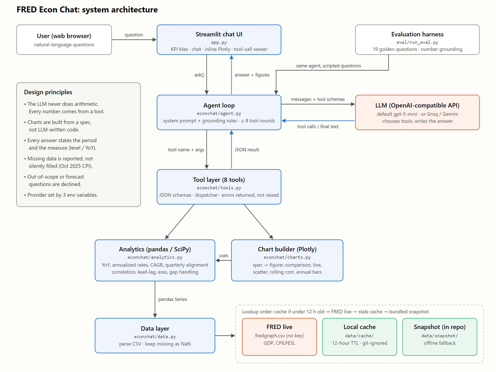
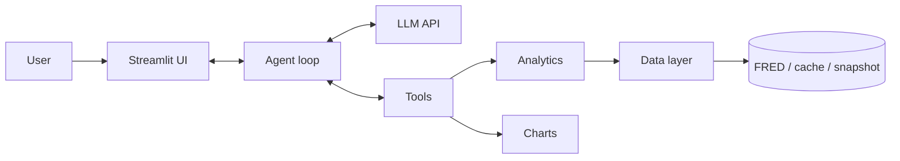

# FRED Econ Chat

A conversational app for exploring two FRED series with plain-English questions:

- **[GDP](https://fred.stlouisfed.org/series/GDP)**: U.S. Gross Domestic Product. Quarterly, nominal, billions of dollars at a seasonally adjusted annual rate. Starts 1947 Q1.
- **[CPILFESL](https://fred.stlouisfed.org/series/CPILFESL)**: Core CPI (all items less food and energy). Monthly, seasonally adjusted index with 1982-84 = 100. Starts January 1957.

Ask things like "How has GDP changed over the past 10 years?", "What is the current core inflation rate?" or "Chart GDP growth against core inflation". The app pulls the latest data from FRED, runs the calculations in Python, and has an LLM explain the results. Charts appear right in the chat.



## Contents

| Item | Location |
|---|---|
| Conversational app | `app.py` + `econchat/` |
| System architecture diagram | [docs/architecture.png](docs/architecture.png) |
| Sample conversations | [docs/sample_conversations.md](docs/sample_conversations.md) (19 questions, with charts) |
| Economic visualizations | [figures/](figures/) |
| Technical report | [report/report.pdf](report/report.pdf) ([Markdown source](report/report.md)) |
| Tests and evaluation | `tests/`, `eval/` |

## How it works

The LLM never does arithmetic. It decides which of eight tools to call, and the tools return exact figures computed with pandas and SciPy. The LLM then writes the answer from those results. Every number in an answer can be traced back to a tool result, and the evaluation script checks this automatically.

| Layer | File | What it does |
|---|---|---|
| UI | `app.py` | Streamlit chat, headline metrics, example questions, optional tool-call viewer |
| Agent | `econchat/agent.py` | System prompt with grounding rules; the tool-calling loop (works with any OpenAI-compatible API) |
| Tools | `econchat/tools.py` | 8 function schemas and their dispatcher |
| Analytics | `econchat/analytics.py` | YoY / annualized rates, CAGR, quarterly alignment, correlations, lead-lag, eras |
| Charts | `econchat/charts.py` | JSON spec → Plotly figure (comparison, line, scatter, rolling correlation, annual bars) |
| Data | `econchat/data.py` | Downloads FRED CSVs (no API key needed), caches for 12 h, falls back to `data/snapshot/` when offline |



## Run it locally

Requires Python 3.11 or newer.

```bash
git clone <this repo>
cd fred-econ-chat
python -m venv .venv
# Windows:      .venv\Scripts\activate
# macOS/Linux:  source .venv/bin/activate
pip install -r requirements.txt
cp .env.example .env        # Windows: copy .env.example .env
```

Open `.env` and paste an API key after `LLM_API_KEY=`, then:

```bash
streamlit run app.py
```

The app opens at http://localhost:8501. Without a key, it still shows the headline numbers and explains how to add one.

### Choosing an LLM provider

Any OpenAI-compatible endpoint works. Set the three variables in `.env`:

| Provider | `LLM_BASE_URL` | `LLM_MODEL` | Cost |
|---|---|---|---|
| OpenAI (default) | *(blank)* | `gpt-5-mini` | about $0.002 per question |
| Groq | `https://api.groq.com/openai/v1` | `llama-3.3-70b-versatile` | free tier |
| Google Gemini | `https://generativelanguage.googleapis.com/v1beta/openai/` | `gemini-2.5-flash` | free tier |

Results in `docs/` were produced with `gpt-5-mini`. Tool calling on the other providers is generally reliable but less thoroughly tested here.

## Questions it handles

- Latest values: "What is the latest reported U.S. GDP?"
- Change over time: "How has GDP changed over the past 10 years?" or "How much have core prices risen since 2020?"
- Inflation rates: "What is the current Core CPI inflation rate?" or "What was core inflation in June 2022?"
- The relationship: "What is the relationship between GDP growth and core inflation?" or "Does it hold without the pandemic?"
- Charts: comparisons over time, scatter by era, rolling correlation, annual bars, any series and transform
- Summaries: "Summarize the key economic trends in both datasets."
- Limits: requests for other data (unemployment, real GDP) or for forecasts are declined, with an explanation of what is available

See [docs/sample_conversations.md](docs/sample_conversations.md) for full transcripts with charts.

## Data notes

- **October 2025 Core CPI is missing.** BLS did not publish it because of the federal government shutdown. The app keeps it missing, so the year-over-year rate for October 2026 can't be computed directly. In that case the app reports the latest computable rate and an estimate based on an interpolated base month, labelled as an estimate.
- **GDP is nominal.** Its growth includes inflation, so "real growth proxy" (nominal GDP growth minus core CPI inflation) is offered as an approximation. A proper measure would use real GDP and the GDP deflator.
- **GDP is revised after release.** Answers state when the data was retrieved.

## Tests and evaluation

```bash
pytest -q                     # 24 unit tests: transforms, gaps, tools, charts, agent loop (no key needed)
python -m eval.run_eval       # 19 scripted questions through the real LLM; writes docs/sample_conversations.md
python -m scripts.make_figures   # regenerates figures/report_*.png
```

`eval/run_eval.py` checks that each answer used an appropriate tool, produced a chart when one was asked for, and contains only numbers found in that turn's tool results.

## Repository layout

```
app.py                  Streamlit app
econchat/               data, analytics, charts, tools, agent
eval/                   golden questions, evaluation runner, results.json
scripts/make_figures.py report figures
tests/                  pytest suite
data/snapshot/          bundled FRED data (offline fallback)
docs/                   architecture diagram, sample conversations
figures/                chart images
report/                 technical report (Markdown and PDF)
```

Data: U.S. Bureau of Economic Analysis and U.S. Bureau of Labor Statistics, retrieved from FRED, Federal Reserve Bank of St. Louis.
