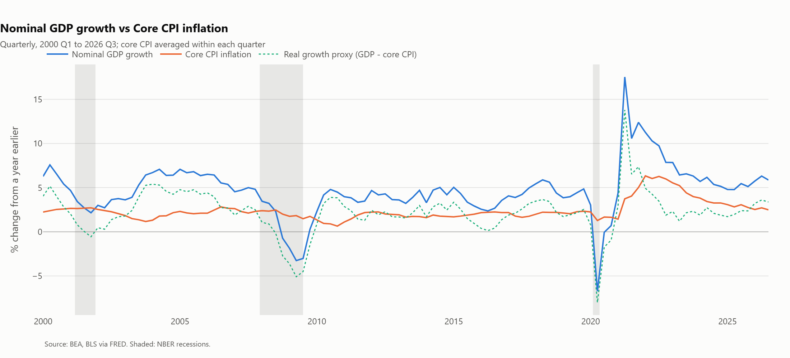
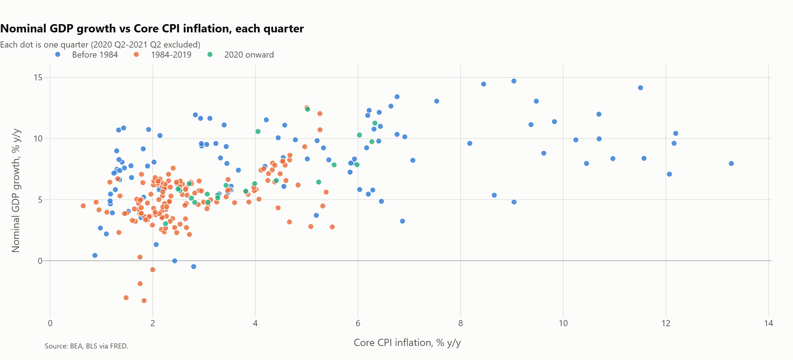
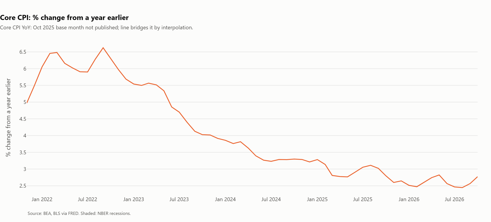
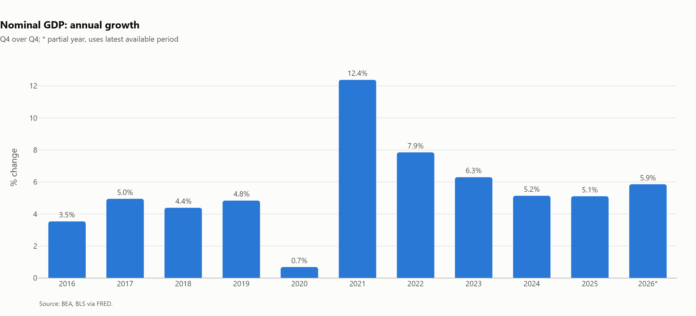

# Sample conversations

Generated by `python -m eval.run_eval` on 2026-11-15 09:50 with model `gpt-5-mini`. Data retrieved from FRED 2026-11-15 17:24 UTC.
Each answer lists the tools it called. Charts are saved to `figures/`.

## The seven required questions

**User:** What is the latest reported U.S. GDP?

**Assistant:** The latest reported U.S. nominal GDP is $33.01 trillion in 2026 Q3.  

- Series and period: Gross Domestic Product (nominal) level for 2026 Q3 = $33.01 trillion.  
- Change from prior quarter: 2026 Q2 level = $32.56 trillion.  
- Growth rates: 2026 Q3 QoQ annualized growth = 5.61%; QoQ (not annualized) = 1.37%; year‑over‑year growth = 5.87%.  
- Note: this is nominal GDP (includes price changes). Data retrieved 2026-11-15.

Tools: `get_latest` · 4.6s

---

**User:** How has U.S. GDP changed over the past 10 years?

**Assistant:** Nominal U.S. GDP rose from $18.89 trillion in 2016 Q3 to $33.01 trillion in 2026 Q3, a 74.72% increase (CAGR 5.74%).  

- Start level: 2016 Q3 = $18.89 trillion.  
- End level: 2026 Q3 = $33.01 trillion.  
- Total change: +74.72% over the 10-year window; annualized rate = 5.74%.  
- YoY growth path: 2016 Q3 YoY = 2.67%; peak YoY = 17.53% in 2021 Q2; trough YoY = -6.73% in 2020 Q2; 2026 Q3 YoY = 5.87%.  
- Notable quarterly declines: 2020 Q1 QoQ = -0.83% and 2020 Q2 QoQ = -8.24%.

If you’d like a chart of nominal GDP levels or YoY growth over the decade, I can create one.

Tools: `compute_change` · 5.7s

---

**User:** What is the current Core CPI inflation rate?

**Assistant:** The latest Core CPI inflation rate (YoY) cannot be computed for October 2026 because the comparison month October 2025 was never published.  

- Latest month and issue: October 2026 — YoY not computable (missing 2025-10).  
- Most recent computable YoY: September 2026 YoY = 2.57%.  
- Shorter-run rates for October 2026: 3‑month annualized = 3.75%; 6‑month annualized = 2.69%; month‑over‑month (Oct 2026) = 0.30%.  
- Note: "Core CPI inflation rate" means the year‑over‑year % change; the October 2026 official YoY is unavailable due to a missing base month (BLS publication gap). An interpolated estimate for Oct 2026 is 2.77% but it is not an official BLS figure.

Tools: `core_inflation` · 4.9s

---

**User:** How has Core CPI inflation changed over the past five years?

**Assistant:** Core CPI (YoY) fell from 4.59% in October 2021 to 2.57% in September 2026, with a peak of 6.62% in September 2022 and a trough of 2.45% in August 2026.  

- Start level: index 281.668 in 2021-10.  
- End level: index 339.9 in 2026-10 (index levels, not inflation rates).  
- Five‑year cumulative change: +20.67% (core prices up 20.67% from 2021-10 to 2026-10); average annual core inflation = 3.83%.  
- YoY path: 2021-10 YoY = 4.59%; peak YoY = 6.62% (2022-09); trough YoY = 2.45% (2026-08); latest computable YoY = 2.57% (2026-09).  

Note: the official October 2026 YoY cannot be computed if the October 2025 base month is missing; the latest computable YoY is September 2026 (2.57%).

Tools: `compute_change` · 8.0s

---

**User:** What is the relationship between GDP growth and Core CPI inflation?

**Assistant:** Nominal GDP growth and Core CPI inflation have tended to move together: over 1958 Q1–2026 Q3 the Pearson correlation between nominal GDP YoY growth and Core CPI YoY is 0.54.  

- Long-run averages: average nominal GDP YoY = 6.44% (1958 Q1–2026 Q3) and average Core CPI YoY = 3.68%; the simple real‑growth proxy (nominal GDP growth minus core inflation) averages 2.75%.  
- Latest quarter (2026 Q3): nominal GDP YoY = 5.87% and quarterly-averaged Core CPI YoY (2026-07 to 2026-09) = 2.49%, giving a real‑growth proxy of 3.37% (approximation).  
- Lead/lag: correlation is strongest with GDP leading inflation by about 6 quarters (k = 6, corr = 0.67), and contemporaneous correlation is 0.537.  
- By era: the 2020‑present period shows a high correlation (0.77), while 2008–2019 was weak (0.04).  
- Caveats: GDP here is nominal, so part of the positive co‑movement is mechanical; using the real‑growth proxy reduces the correlation (real_proxy vs core inflation Pearson r = −0.32). Correlation is not causation.

Tools: `compare_growth_inflation` · 6.3s

---

**User:** Generate a visualization comparing GDP growth and Core CPI inflation over time.

**Assistant:** Chart shows nominal GDP YoY growth (blue), Core CPI YoY inflation (orange), and the real-growth proxy (green dotted). The blue line spikes during 2020 and 2021 and again shows elevated quarters in 2026; the orange line peaks around 2022 and falls thereafter. Gray bands mark recessions. Correlation is visible but not perfect; real-growth proxy often lies between the other two.

Tools: `make_chart` · 3.7s

---

**User:** Summarize the key economic trends observed in both datasets.

**Assistant:** Nominal GDP has grown strongly over the long run while core CPI inflation has fallen from its 2022 peak and settled at a lower rate recently; the two series move together at times but correlation is not causation.

- Long run (decades): average nominal GDP growth (YoY) since 1947 is 6.37% and core CPI averages by decade show the high‑inflation 1970s–80s (core ~6.5% in the 1970s and ~6.1% in the 1980s) versus the low‑inflation 2010s (core ~1.85%).  
- Recent episode (pandemic → inflation spike → cooling): post‑2020 the pandemic produced large swings; core CPI peaked at 6.62% (2022‑09) and then fell, while nominal GDP YoY showed a sharp trough in 2020 Q2 and recovered thereafter.  
- Latest readings and relationship: GDP level 2026 Q3 = $33.01 trillion; nominal GDP YoY (2026 Q3) = 5.87%; core CPI latest computable YoY = 2.57% (September 2026) and the quarter‑average core CPI (2026‑07 to 2026‑09) = 2.49%, giving a simple real‑growth proxy of 3.37% for 2026 Q3 (nominal GDP YoY minus quarter‑avg core CPI; approximation).  
- Relationship metrics and caveats: full‑sample correlation (nominal GDP YoY vs core CPI YoY) ≈ 0.53; the relationship strengthens in the 2020‑present era (corr ≈ 0.68). Remember nominal GDP includes price changes, so part of co‑movement is mechanical and correlation is not causation.

Tools: `trend_summary` · 7.7s

---

## Follow-ups and other charts

**User:** Does that relationship hold if you leave out the pandemic quarters?

**Assistant:** Yes — excluding the pandemic quarters, nominal GDP growth still positively correlates with core CPI inflation: Pearson r = 0.54 (270 quarters), and the real-growth proxy (nominal growth minus core inflation) is negatively correlated with core inflation: Pearson r = −0.32.

- Correlation (1958 Q1 to 2026 Q3, pandemic quarters excluded): nominal GDP growth vs core CPI YoY Pearson r = 0.537 (n = 270).  
- Real-growth proxy (nominal growth − core inflation) vs core CPI YoY: Pearson r = −0.321 (n = 270), showing that removing inflation from nominal growth flips the sign.  
- Latest quarter (2026 Q3, core CPI averaged Jul–Sep 2026): nominal GDP YoY = 5.87% and core CPI YoY = 2.49%, so the real-growth proxy ≈ 3.37%.  
- Lead/lag: strongest positive correlation occurs when GDP growth leads core inflation by 6 quarters (corr = 0.668), suggesting GDP growth often precedes inflation movements.  
- Caveats: GDP is nominal (so part of co-movement is mechanical); correlation is not causation and results depend on era (correlations vary by period).

If you want, I can show a chart comparing quarterly nominal GDP YoY and core CPI YoY without the pandemic quarters.

Tools: `compare_growth_inflation` · 7.4s

---

**User:** Show it as a scatter plot.

**Assistant:** I've created the scatter plot comparing quarterly nominal GDP YoY (x-axis) and core CPI YoY (y-axis), excluding the pandemic quarters.

- The chart has 270 points and uses three colors: blue for "Before 1984", orange for "1984-2019", and green for "2020 onward".
- Pearson correlation with the pandemic quarters excluded is 0.54. 
- The scatter shows a clear positive slope: higher nominal GDP YoY tends to be associated with higher core CPI YoY, though points are dispersed — correlation is not causation.

Tools: `make_chart` · 3.5s

---

**User:** Plot core inflation over the last five years.

**Assistant:** I plotted core CPI YoY for the past five years; the latest official YoY is 2.57% (September 2026) and the October 2026 YoY is an estimate at 2.77%.

- Level five years ago: November 2021 core CPI YoY = 4.97%.  
- Peak in window: September 2022 core CPI YoY = 6.62%.  
- Most recent trough: August 2026 core CPI YoY = 2.45%.  
- Note: October 2026 (2.77%) is labeled an estimate because a base month (October 2025) was not published; the latest official month is September 2026 (2.57%).

The chart (orange line) shows core inflation rising to a peak in September 2022 and then trending downward with volatility toward mid-2026, reaching the low in August before the estimated October reading. The orange line highlights the overall decline from the 2022 peak to the current lower readings.

Tools: `make_chart` · 9.2s

---

**User:** How much have core consumer prices risen since January 2020?

**Assistant:** Core consumer prices (core CPI) have risen 27.44% from January 2020 to October 2026.

- Index level: January 2020 = 266.716, October 2026 = 339.90.  
- Cumulative increase (Jan 2020 → Oct 2026): 27.44%.  
- Average annualized rate over the period: 3.66% per year.  
- Core CPI YoY at the start and end: January 2020 YoY = 2.28%, September 2026 YoY = 2.57%.  

Note: the percent change is the cumulative rise in the CPILFESL index between the two dates; the annualized rate is the average yearly increase over the window.

Tools: `compute_change` · 4.6s

---

## Specific dates and paraphrases

**User:** what was gdp at the end of 2008?

**Assistant:** Nominal U.S. GDP at the end of 2008 (2008 Q4) was $14.61 trillion (level, seasonally adjusted annual rate).

- Label: 2008 Q4 level = $14.61 trillion (14,608.209 billion).  
- Measure: nominal GDP, seasonally adjusted annual rate.  
- Period: 2008 Q4.

Tools: `get_observations` · 6.0s

---

**User:** What was core inflation in June 2022?

**Assistant:** Core CPI inflation in June 2022 was 5.91% year-over-year.

- Label: June 2022 core CPI YoY = 5.91% (year-over-year % change in CPILFESL).  
- Short-term rates: 3-month annualized = 7.09%; 6-month annualized = 6.32%.  
- Monthly change: June 2022 month-over-month = 0.68%.

Tools: `core_inflation` · 4.2s

---

**User:** How big is the US economy right now in trillions?

**Assistant:** The U.S. nominal economy is $33.01 trillion in 2026 Q3 (level, seasonally adjusted annual rate).

- Label: 2026 Q3 level = $33.01 trillion (nominal GDP, SAAR).  
- Quarter change: 2026 Q3 QoQ annualized growth = 5.61%.  
- Year change: 2026 Q3 YoY growth = 5.87%.  
- Data vintage: latest observation 2026 Q3 (data retrieved 2026-11-15).

Tools: `get_latest` · 4.1s

---

**User:** Show annual GDP growth for the last 10 years as a bar chart.

**Assistant:** Chart: annual GDP growth (Q4/Q4) for the last 10 years shown as bars.

- The chart shows GDP annual growth rates by year with bars (years colored by default). The tallest bar is 2021 at 12.39% and the most recent full year shown (2025) is 5.12%; 2026 uses 2026 Q3 as the latest period with YoY 5.87%.  
- Values: 2016 = 3.55%, 2017 = 4.96%, 2018 = 4.40%, 2019 = 4.85%, 2020 = 0.70%, 2021 = 12.39%, 2022 = 7.86%, 2023 = 6.31%, 2024 = 5.15%, 2025 = 5.12%, 2026 Q3 = 5.87%.

Tools: `make_chart` · 3.9s

---

## Edge cases and out-of-scope questions

**User:** What was U.S. GDP in 1930?

**Assistant:** I can’t provide U.S. GDP for 1930 because this app’s GDP series does not cover that year; the latest available observation is 2026 Q3 with nominal GDP $33.01 trillion.

- Latest period and level: 2026 Q3 nominal GDP $33.01 trillion (series latest_value_trillions).  
- Growth context: 2026 Q3 QoQ annualized growth 5.61% and YoY growth 5.87% (qoq_annualized_growth_pct; yoy_growth_pct).  
- Note: this GDP series is nominal (includes price changes). If you want a long historical estimate that covers 1930, that is outside the app’s data; I can instead show the available GDP history, produce an annual table, or run a chart of the series back to its earliest observation. Which would you prefer?

Tools: `get_latest` · 11.1s

---

**User:** What is the current unemployment rate?

**Assistant:** I don’t have unemployment data in this app — the unemployment rate is outside the two-series dataset available here (GDP and CPILFESL). I can’t fetch unemployment.

- Latest nominal GDP: 2026 Q3 level $33.01 trillion.  
- GDP growth: 2026 Q3 QoQ annualized growth 5.61% and YoY growth 5.87%.  
- Core CPI (CPILFESL) latest index: October 2026 level 339.9 (index). The official YoY core inflation for October 2026 cannot be computed because October 2025 is missing; the latest computable YoY is September 2026 at 2.57%.  
- If you want unemployment, I can’t provide it here — I can instead (a) show a chart comparing nominal GDP growth and core CPI, (b) produce an annual table for GDP or core CPI, or (c) compute recent changes in either available series. Which would you like?

Tools: `get_latest`, `get_latest` · 6.3s

---

**User:** Will core inflation fall below 2% next year?

**Assistant:** I can’t say whether core inflation will fall below 2% next year — that’s a forecast and is outside the two-series historical data in this app. 

- Latest official YoY core CPI: 2026-09 = 2.57% (the latest computable year‑over‑year rate).  
- October 2026 YoY is not published/computeable because October 2025 is missing; the 2026-10 YoY cannot be computed.  
- Short-term momentum (Oct 2026): 3‑month annualized = 3.75% and 6‑month annualized = 2.69%; month‑to‑month (Oct 2026) = 0.30%.  
- Recent trend (past 3 years, 2023-10 to 2026-10): index rose from 311.457 to 339.9, cumulative +9.13%, annualized rate 2.96%; YoY in window started at 4.03% (2023-10) and bottomed at 2.45% (2026-08). 

If you’d like, I can (a) make a chart of core CPI YoY and short-run annualized rates, or (b) compute the path of YoY inflation over a custom period. Which do you want?

Tools: `core_inflation`, `compute_change` · 6.8s

---

**User:** What is real GDP growth right now?

**Assistant:** I can’t give “real GDP growth” exactly because this app doesn’t contain a real (inflation‑adjusted) GDP series — only nominal GDP and core CPI are available; you can form a rough proxy by subtracting core CPI YoY from nominal GDP growth.

- Nominal GDP growth (2026 Q3): QoQ annualized 5.61% and YoY 5.87%.  
- Core CPI inflation (latest computable YoY): September 2026 = 2.57% (October 2026 YoY is not computable because October 2025 is missing).  
- Real‑growth proxy (nominal GDP growth minus core CPI YoY) is the appropriate approximation, but I cannot report a calculated number here; using the figures above you can subtract 2.57% from the nominal growth measure you prefer (QoQ annualized or YoY).  
- Note: this proxy is nominal GDP growth minus core inflation and is only an approximation; correlation is not causation.  

Would you like me to make a chart comparing nominal GDP YoY and core CPI YoY (it will show the latest computable core CPI point for September 2026)?

Tools: `get_latest`, `core_inflation`, `compare_growth_inflation` · 14.2s

---
