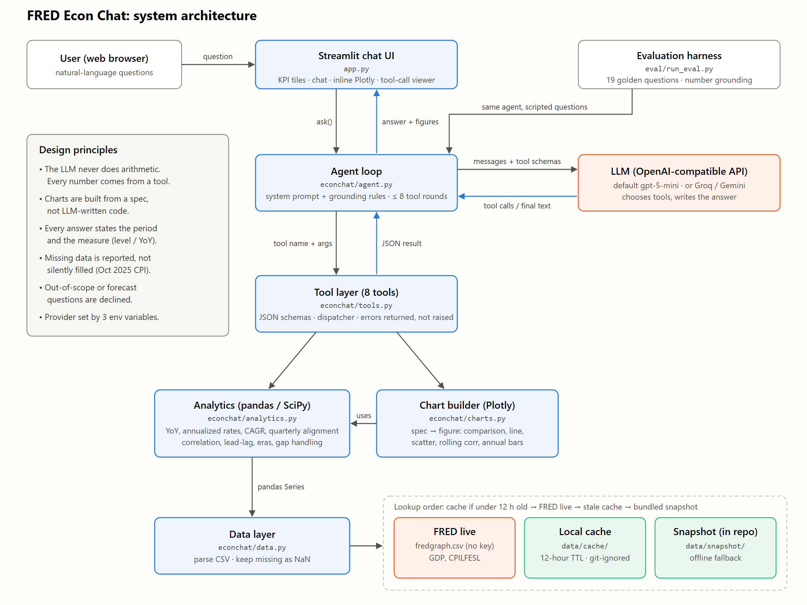
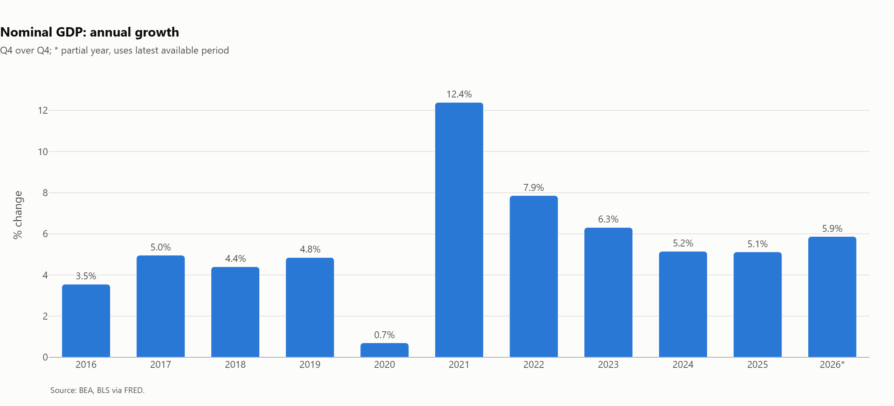
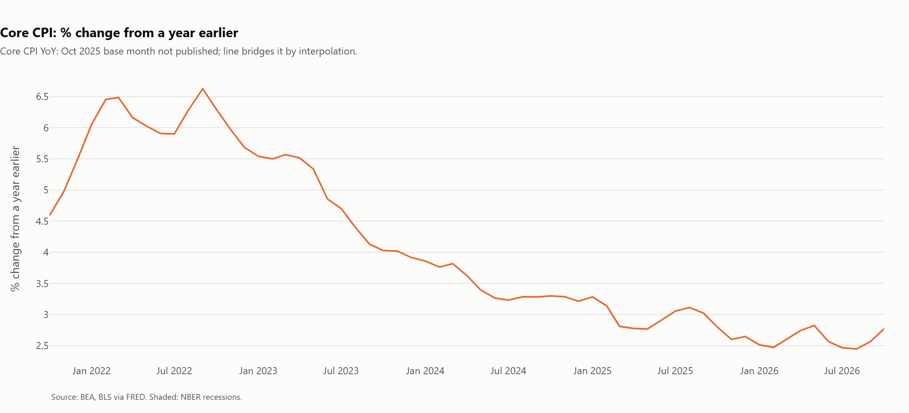
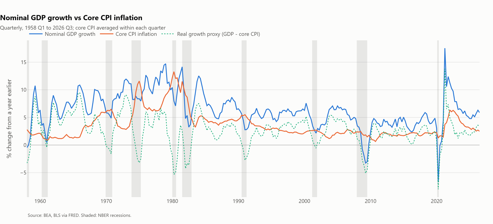
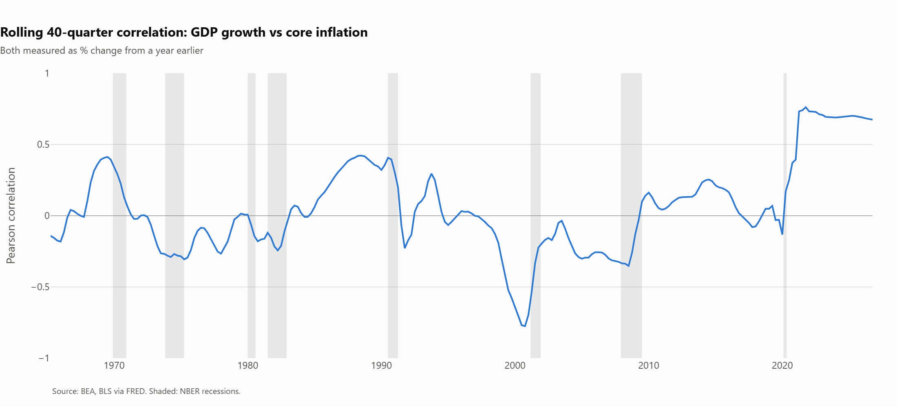

# FRED Econ Chat: An LLM-Powered Conversational Interface for U.S. GDP and Core CPI

**Technical report** · Data retrieved from FRED on 15 November 2026 · Model: `gpt-5-mini`

## 1. Objective

The goal was to build a conversational application that lets a user ask plain-English questions about two FRED series, U.S. Gross Domestic Product (`GDP`) and Core CPI (`CPILFESL`), and get accurate answers, calculated indicators, trend descriptions and charts. The application must handle questions about the latest values, change over time, the current inflation rate, the relationship between GDP growth and core inflation, visual comparisons, and overall summaries.

The main design requirement was **trustworthy numbers**. Language models are fluent but unreliable at arithmetic and prone to stating plausible figures that were never computed. The system is built so that the model never produces a number itself.

## 2. Data

| | GDP | CPILFESL (Core CPI) |
|---|---|---|
| Source | BEA via FRED | BLS via FRED |
| Frequency | Quarterly, from 1947 Q1 | Monthly, from Jan 1957 |
| Units | Billions of dollars, seasonally adjusted annual rate, **nominal** | Index, 1982-84 = 100, seasonally adjusted |
| Latest observation | 2026 Q3: $33,010.0 bn | October 2026: 339.900 |

Both series are downloaded from FRED's public CSV endpoint (`fredgraph.csv`), which needs no API key. Three properties of the data shaped the design:

1. **A missing month.** The October 2025 Core CPI value is blank in FRED because BLS did not publish it during the federal government shutdown. The year-over-year rate for October 2026 therefore cannot be computed from published data. The system keeps the gap rather than filling it silently. It reports the latest computable rate (September 2026) and, separately, an estimate based on a log-linearly interpolated base month, clearly labelled as an estimate.
2. **Nominal GDP.** GDP growth includes inflation, so "GDP growth vs. inflation" is partly an identity: nominal growth ≈ real growth + inflation. The system offers a *real growth proxy* (nominal GDP growth minus core CPI inflation) and calls it an approximation, since the proper deflator is the GDP price index.
3. **Mixed frequencies.** To compare the series, core CPI is averaged within each quarter (at least 2 of 3 months required) and both are expressed as year-over-year % changes.

## 3. System architecture



The application has five layers:

- **Data layer** (`data.py`). Downloads both CSVs, parses missing values as NaN, and caches the files for 12 hours. If FRED is unreachable it falls back to the stale cache and then to a snapshot bundled in the repository, so the app always starts.
- **Analytics layer** (`analytics.py`). Pure pandas and SciPy functions: YoY, MoM, quarterly-annualized and 3- and 6-month annualized rates, CAGR, quarterly alignment, Pearson and Spearman correlation, lead-lag correlation, era breakdowns, and rolling correlation. Every result is a JSON-ready dictionary that names its periods and definitions.
- **Tool layer** (`tools.py`). Eight functions exposed to the LLM with JSON schemas: `get_latest`, `core_inflation`, `compute_change`, `annual_table`, `get_observations`, `compare_growth_inflation`, `trend_summary` and `make_chart`. Errors such as dates out of range are returned to the model as data, so it can explain them instead of crashing.
- **Agent** (`agent.py`). A standard tool-calling loop of up to 8 rounds over the Chat Completions API. A system prompt fixes the grounding rules:

    - every number must come from a tool result;
    - each figure names its period and measure;
    - out-of-scope and forecast questions are declined;
    - causal claims are not allowed.

    Because it uses only the OpenAI-compatible API, the provider can be switched with three environment variables (OpenAI, Groq or Gemini).

- **UI** (`app.py`). A Streamlit chat with headline metrics, example-question buttons, interactive Plotly charts inline, and an optional viewer showing the tool calls behind each answer.

**Key design decisions**

- *Tool calling rather than a code-executing "pandas agent".* Letting the model write and run code is more flexible but non-deterministic, harder to test and a security risk. Fixed, unit-tested tools make every figure reproducible and traceable.
- *Charts from a spec, not from generated code.* The model chooses a chart type, series, transform and window, and `charts.py` builds the figure. All charts therefore share one visual system:

    - fixed colors (GDP blue, core CPI orange);
    - NBER recession shading;
    - never two y-axes. Series in different units are indexed to 100 or shown as rates.

- *Conversation memory keeps only the final question and answer texts*, not raw tool payloads. This keeps follow-up questions cheap while still allowing references like "show it as a scatter plot".

## 4. Analytical methods

| Measure | Definition |
|---|---|
| YoY % change | x<sub>t</sub> / x<sub>t−4</sub> − 1 (quarterly) or x<sub>t</sub> / x<sub>t−12</sub> − 1 (monthly). This is the headline "inflation rate". |
| Quarterly annualized | (x<sub>t</sub> / x<sub>t−1</sub>)<sup>4</sup> − 1. This is how BEA reports GDP growth. |
| 3-month / 6-month annualized | (x<sub>t</sub> / x<sub>t−3</sub>)<sup>4</sup> − 1 and (x<sub>t</sub> / x<sub>t−6</sub>)<sup>2</sup> − 1. These show inflation momentum. |
| CAGR | (x<sub>end</sub> / x<sub>start</sub>)<sup>1/years</sup> − 1 |
| Real growth proxy | nominal GDP YoY − core CPI YoY (quarterly) |
| Lead-lag | corr(GDP growth<sub>t</sub>, core inflation<sub>t+k</sub>) for k = −8…8 quarters |
| Eras | 1958–83 (high inflation), 1984–2007 (Great Moderation), 2008–19 (post-financial-crisis), 2020–present |

Pandemic sensitivity: 2020 Q2 to 2021 Q2 can be excluded, because those YoY rates are dominated by the collapse and its base effect.

## 5. Findings

### 5.1 GDP

- Nominal GDP reached **$33.01 trillion in 2026 Q3**. That is 5.61% quarterly annualized growth and **5.87% year over year**.
- Over the past ten years (2016 Q3 to 2026 Q3), GDP rose from $18.89 trillion to $33.01 trillion, up 74.7%. That is a **5.74% compound annual rate**, slightly above the 4.43% 20-year rate because of high post-2020 inflation.
- Growth was steady at 3.5–5% a year (Q4 over Q4) before the pandemic. It then went through the deepest quarterly drop on record, −8.24% in 2020 Q2 (versus −1.95% in 2008 Q4), and a 12.4% rebound in 2021. Since then it has eased back toward 5–6%.



### 5.2 Core CPI inflation

- **Current rate:** the latest computable core inflation rate is **2.57% (September 2026)**. The official October 2026 year-over-year rate cannot be computed because of the October 2025 gap; the interpolated estimate is 2.77%. Short-run momentum is mixed: 3.75% on a 3-month annualized basis versus 2.69% over 6 months.
- **Last five years:** core inflation went from 4.59% in October 2021 to a **peak of 6.62% in September 2022**, the highest since August 1982. It then fell steadily to a low of 2.45% in August 2026. Core prices rose a cumulative 20.67% over the five years, an average of 3.83% a year.
- **Long run:** decade averages show the 1970s (6.49%) and 1980s (6.07%) high-inflation era, peaking at 13.6% in June 1980. The 2010s averaged 1.85%. The 2020s so far average 3.64%.



### 5.3 Relationship between GDP growth and core inflation



| Statistic (quarterly YoY, 1958 Q1–2026 Q3) | All quarters | Pandemic excluded |
|---|---|---|
| Pearson r: nominal GDP growth vs core inflation | **0.525** (n = 275) | 0.537 (n = 270) |
| Spearman ρ | 0.533 | 0.521 |
| Pearson r: real growth proxy vs core inflation | **−0.276** | −0.321 |
| Strongest lead-lag correlation | k = +3 quarters, r = 0.635 | k = +6, r = 0.668 |

| Era | Avg nominal GDP growth | Avg core inflation | Avg real proxy | r |
|---|---|---|---|---|
| 1958–1983 | 8.19% | 4.92% | 3.27% | 0.41 |
| 1984–2007 | 5.94% | 3.18% | 2.77% | 0.32 |
| 2008–2019 | 3.39% | 1.87% | 1.52% | 0.04 |
| 2020–present | 6.24% | 3.63% | 2.61% | 0.68 |

What the numbers show:

1. **The positive correlation is real but largely mechanical.** Nominal GDP contains the price level, so higher inflation raises measured GDP growth. Once inflation is subtracted out, the real growth proxy is *negatively* related to inflation (r ≈ −0.28 to −0.32). High-inflation periods, such as the 1970s and 2022, came with weaker real growth.
2. **It is a low-frequency, regime-level relationship.** The 40-quarter rolling correlation (below) stays mostly between −0.3 and +0.4 and reached −0.78 around 2000. Within a decade, the two series do not track each other reliably. The full-sample r comes mainly from shared long-run regimes, with high values of both in the 1970s and low values of both in the 2010s. In 2008–2019 the two were essentially unrelated (r = 0.04).
3. **GDP growth tends to lead core inflation.** Correlations rise from k = 0 to a plateau at k = 3–6 quarters. This fits the idea that demand pressure shows up in prices with a lag, but a common driver such as monetary policy could produce the same pattern. It is evidence of timing, not causation.
4. **The post-2020 link (r ≈ 0.68) is driven by a single episode.** That episode is the pandemic collapse, the rebound and the inflation surge. The relationship holds when the most distorted quarters are excluded, but one episode is a thin basis for generalizing.



## 6. Evaluation

**Unit tests.** 24 pytest tests run without an API key. They cover:

- CSV parsing of blank and "." values;
- exact growth formulas on synthetic series;
- missing months not being bridged, and the interpolated estimate recovering the true rate;
- `years_back` windows, quarterly alignment, and clear errors for out-of-range dates;
- every tool and chart on real data;
- the agent loop, run with a scripted fake LLM.

**End-to-end evaluation** (`eval/run_eval.py`). 19 questions in 4 conversations: the 7 required questions, follow-ups that depend on context, specific dates and paraphrases, and edge cases (GDP in 1930, unemployment, a forecast request, "real GDP"). Each answer is checked automatically on three things:

- an appropriate tool was called;
- a chart was produced when one was requested;
- **every number in the answer appears in the tool results of that conversation**, allowing for rounding and conversion to trillions.

| Metric | Result |
|---|---|
| Appropriate tool selected | 19 / 19 |
| Chart produced when requested | 4 / 4 |
| Numbers checked / not traceable to a tool | 154 / **0** |
| Latency per answer (median, range) | 6.0 s (3.5–14.2 s) |
| Tokens per 19-question run | ≈ 98k input, 9k output (about $0.04 with `gpt-5-mini`) |

**Issues found by evaluation and fixed:**

- **Wrong measure for an inflation question.** "How has inflation changed?" was answered with the change in the index level. The tool now returns the YoY rate at the start and end of the window, and the prompt asks for the path of the rate.
- **Wrong line color.** A chart description called the orange line "red". The chart tool now reports each line's color.
- **Estimate presented as official, and a misread peak.** The interpolated October 2026 estimate was given as an official figure, and the window's first point was called its peak. The chart tool now returns labelled start, end, high and low values and flags estimated points.
- **Wrong month named as missing.** The model said the October 2026 index was missing. The tool's explanation now states explicitly which month is missing.

These are errors of interpretation, not invented numbers. An automated number check cannot catch them, which is why the transcripts were also reviewed by hand.

Full transcripts with charts are in `docs/sample_conversations.md`.

## 7. Limitations and future work

- **Nominal-only GDP.** Adding real GDP (`GDPC1`) and the GDP deflator would replace the proxy with a proper real growth rate. PCE inflation would allow comparison with the Fed's 2% target.
- **Revisions.** Answers reflect the data as of retrieval. Vintage analysis through ALFRED would show how GDP estimates change after release.
- **Semantic checking.** The grounding check proves that numbers are traceable, not that they are interpreted correctly. An LLM-as-judge or rubric review could be added for that.
- **Statistics.** Correlations on overlapping YoY rates are autocorrelated, so the reported p-values overstate significance. HAC standard errors or a VAR/Granger framework would be the rigorous next step.
- **Forecasting** is deliberately out of scope.

## 8. How to run

```bash
pip install -r requirements.txt
cp .env.example .env     # add LLM_API_KEY
streamlit run app.py
```

See `README.md` for provider options, tests and evaluation commands.
